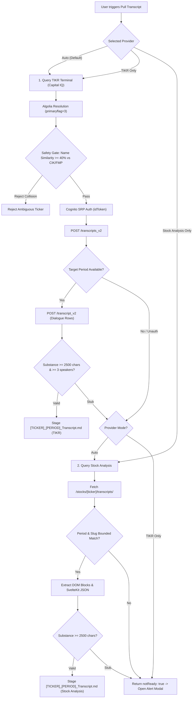

# Transcript Ingestion Protocol & Dual-Provider Architecture

## 1. Overview
Earnings call transcripts provide critical management commentary, operational tone, CapEx breakdown, and analyst pushback. The Value Investing Terminal operates under an authoritative dual-provider architecture prioritizing **TIKR Terminal (S&P Capital IQ)** for fast-turnaround verbatim dialogues, with **Stock Analysis** (`stockanalysis.com`) as an automated secondary fallback.

---

## 2. Tiered Provider Ingestion Workflow

---

## 3. TIKR Terminal (Capital IQ) Integration

### A. Authentication
- **User Pool:** AWS Cognito User Pool `us-east-1_PflCYM8WM`, ClientId `7ls0a83u5u94vjb2g6t6mdenik`.
- **Protocol:** Secure Remote Password (SRP) via `amazon-cognito-identity-js`.
- **Token Caching:** Caches the JWT `idToken` in memory for 50 minutes (standard expiry: 60 minutes).
- **Environment Variables:** `TIKR_EMAIL` and `TIKR_PASSWORD` stored in `.env`.

### B. Algolia Company Resolution & Multi-Market Safety Gate
- **Directory Index:** `tikr-terminal-v1` on Algolia App `TJPAY1DYT8`.
- **Primary Listing Prioritization:** Candidates are filtered and sorted prioritizing `primaryflag === 3` (primary home exchange listing).
- **Disambiguation Gate (`calculateNameSimilarity`):**
  - TIKR indexes global equities across hundreds of markets. Companies on the BMV (Mexico), Frankfurt, or London often share identical ticker symbols with US equities.
  - To prevent pulling foreign or secondary listings, the candidate company name is compared against the canonical SEC CIK or FMP company profile name.
  - Tokens are stripped of standard corporate noise words (`inc`, `corp`, `ltd`, `group`, `holdings`, `class`).
  - Strict requirement: $\ge 40\%$ token overlap. Any candidate under $40\%$ similarity is rejected with an audit warning.

### C. Endpoints & Markdown Formatting
1. **Transcripts List:** `POST https://api.tikr.com/transcripts_v2` with `{ cid, tid, auth }`.
2. **Transcript Dialogue:** `POST https://api.tikr.com/transcript_v2` with `{ auth, eid, tid, v: "v1", id, cid }`.
3. **Markdown Dialogue Compilation:** Dialogue components are structured into Markdown blocks:
   - Header with Company, Ticker, Period, Headline Date, and Source attribution.
   - Each speaker turn rendered as `### [Speaker Name] ([Speaker Title])` followed by verbatim remarks.
4. **Substance Threshold:** Valid transcripts must contain $\ge 2,500$ characters and $\ge 3$ speaker sections.

---

## 4. Stock Analysis Secondary Fallback

### A. URL Schema
- Authoritative transcripts endpoint: `https://stockanalysis.com/stocks/{symbol}/transcripts/`
- **Invariance:** Never append `/financials/` to transcript routes.

### B. Slug & Period Bounded Matching
- Stock Analysis URLs embed internal CMS database keys (e.g. `/transcripts/402818-q4-2025/`).
- Regular expression period matching must enforce strict delimiter boundaries (`-${yrShort}-`, `-${yrShort}$`, or space boundaries).
- Never allow an unanchored two-digit year (e.g. `28` for 2028) to match an internal ID substring like `402818`.

### C. Dual Extraction (DOM + SvelteKit Script)
- **DOM Mode:** Scrapes `
` speaker elements followed by `
` text blocks.
- **SvelteKit State Mode:** When newly released earnings calls default to the "Summary" tab on initial render, the scraper extracts and decodes the `fullTranscriptBody` and `summaryLongHtml` JSON script state to reconstruct complete verbatim dialogue.

---

## 5. Modal Tripwires & Zero Search Mandate

### A. Zero Search Fallback Mandate
- Google Gemini web search and generative search grounding fallbacks are **permanently eliminated** from all transcript pipelines.
- Transcripts must strictly originate from verified verbatim dialogue sources (TIKR Capital IQ or Stock Analysis) to guarantee zero hallucinated statements.

### B. Unmissable TranscriptAlertModal
- When neither provider has verbatim dialogue ready, the pipeline cleanly returns `notReady: true` with a clear notice.
- `TranscriptAlertModal` opens automatically with:
  1. An unambiguous warning banner stating verbatim dialogue is pending.
  2. Direct navigation links to both **TIKR App** (`https://app.tikr.com`) and **Stock Analysis** (`https://stockanalysis.com/stocks/{symbol}/transcripts/`).
  3. Action buttons allowing the user to either **Close & Wait** (recommended) or **Proceed with SEC Filings Only**.
